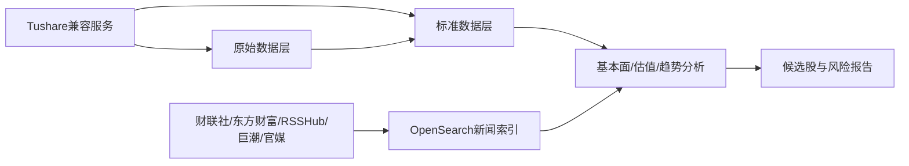
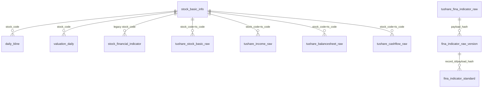

# 当前金融数据模型与来源说明

## 2026-08-07 手动每日决策层

新增 `research.candidate_run`、`research.candidate`、`research.ai_audit`、
`research.human_decision` 和 `portfolio.snapshot_binding`。它们把一个
FROZEN Snapshot 的策略候选、AI 反方审计、人工作决定和纸面组合意图串成
可追溯链路；`portfolio.order_intent.source_type=DAILY_SIGNAL` 必须同时匹配
候选哈希、AI 审计、Snapshot 和 `PENDING_APPROVAL` 状态。

`skills/ashares-decision-audit` 是手动 Skill：候选包和历史数据读取受
截止日期约束，AI 只能返回 `ai-audit-v1` JSON。当前版本没有调度器、券商
连接或自动交易；人工作决定后仍需单独批准纸面意图和录入 `PAPER_MANUAL`
成交。

## 2026-08-07 当前开发状态

阶段三核心代码已完成并通过验证；三日 Baseline Dataset/Run 已真实执行并通过订单、现金、输入哈希和 Raw 不变性审计。当前生产数据库存在三日 FROZEN Dataset 和 SUCCEEDED Run，但尚未生成完整五年历史 Dataset/Run。

完整历史回测前仍需生成每个 SSE 开市日的 `research-v1.3` FROZEN Snapshot，重新执行 v2 Dataset `build→validate→freeze` 和正式 Run 对账。自动实盘交易不在当前范围，Portfolio 保留人工 `PAPER_MANUAL` Air-Gap。数据访问与基座当前状态见 `dev_doc/data_access_current_status_20260818.md`；旧回测状态记录已归档。

## 2026-08-06 阶段三生产增强字段

当前 Backtest/Portfolio 模型已补齐以下能力（Raw 层保持只读）：

- `backtest.order`：`requested_shares`、`planned_shares`、`actual_shares`、`order_audit_hash`、`volume_capacity_shares`、`liquidity_status`、`liquidity_reject_reason`、`risk_policy_version`、理论股数/所需资金/止损风险/跳空压力/费用/滑点/实际风险字段。
- `portfolio.order_intent`：`source_type` 支持 `BACKTEST`，并通过 `source_backtest_run_id`、`source_backtest_order_id`、`source_dataset_id`、`source_signal_id`、`source_order_hash` 建立可审计血缘；BACKTEST 只能进入 `PENDING_APPROVAL`，成交仍固定为 `PAPER_MANUAL`。
- `sql/032_backtest_portfolio_airgap.sql` 是上述字段和触发器的迁移；它不创建、修改或删除任何 `tushare_*_raw` 表。
- Dataset 对非停牌异常成交量/成交额执行失败门禁；规则 JSON 的 `max_volume_participation_pct`、`liquidity_policy` 会进入冻结后的执行规则。期末假设清仓以 `END_OF_DATA_LIQUIDATION` Metric/审计元数据保存，不写入真实 Fill。

执行单位口径：Tushare Raw 的 `daily.vol` 为手、`daily.amount` 为千元；Backtest Dataset 物化后分别统一为股、元。后续任何执行适配器都必须使用标准单位，不得再次乘系数。

更新时间：2026-08-06

本文只描述当前实际启用、已接入或作为分析主模型使用的数据。不列出尚未启用、依赖QMT/MiniQMT且当前为空的QMT专用表。

## 1. 当前系统总览



当前分工：

| 数据域 | 存储 | 主要来源 | 用途 |
|---|---|---|---|
| 股票基础信息 | PostgreSQL | Tushare `stock_basic` | 股票代码、名称、市场、上市状态 |
| 日线行情 | PostgreSQL | Tushare `daily` | K线、均线、趋势、成交量 |
| 估值快照 | PostgreSQL | Tushare `daily_basic` | PE、PB、PS、市值、换手率 |
| 复权因子 | PostgreSQL Raw + Standard | Tushare `adj_factor` | 前复权/后复权计算 |
| 财务指标 | PostgreSQL | Tushare `fina_indicator` | ROE、资产负债率、现金流质量 |
| 三大财务报表 | PostgreSQL原始层 | Tushare `income`、`balancesheet`、`cashflow` | 财务核验、重算指标 |
| 新闻、政策、监管 | OpenSearch | RSS、RSSHub、AkShare、网页/API | 信息发现和交叉验证 |
| 公司公告 | OpenSearch | 巨潮 `cninfo` | 官方公告、年报、风险核验 |

## 2. PostgreSQL标准表

### 2.1 `stock_basic_info`：股票基础信息

来源：Tushare `stock_basic`。

主键：`stock_code`。

| 字段 | 类型 | 含义 |
|---|---|---|
| `stock_code` | varchar | Tushare格式证券代码，例如 `000001.SZ` |
| `symbol` | varchar | 六位股票代码，例如 `000001` |
| `name` | text | 股票名称，可能包含ST、退市标记 |
| `area` | text | 所在地区；源数据为空时为NULL |
| `industry` | text | 行业分类；源数据为空时为NULL |
| `market` | text | 市场板块，如主板、创业板、科创板、北交所 |
| `list_date` | date | 首次上市日期，不是当前交易日期 |
| `delist_date` | date | 退市日期，未退市时为空 |
| `list_status` | varchar | 上市状态：L上市、D退市、P暂停上市等 |
| `source` | varchar | 数据来源，当前为 `tushare` |
| `fetched_at` | timestamp | 本次抓取时间 |

注意：退市股票的`list_date`可能非常早，这是源数据的真实首次上市日期，不是异常值。

### 2.2 `daily_kline`：股票日线行情

来源：Tushare `daily`。

主键：`(stock_code, trade_date)`。

| 字段 | 类型 | 含义 |
|---|---|---|
| `stock_code` | varchar | 证券代码 |
| `trade_date` | date | 交易日期 |
| `open` | double | 开盘价 |
| `high` | double | 最高价 |
| `low` | double | 最低价 |
| `close` | double | 收盘价 |
| `volume` | double | 成交量，已将Tushare的手转换为股：`vol * 100` |
| `amount` | double | 成交额，已将Tushare的千元转换为元：`amount * 1000` |

价格是Tushare `daily`的原始日线价格，不应直接当作前复权价格。复权分析应使用复权因子计算派生价格。

### 2.3 `valuation_daily`：每日估值快照

来源：Tushare `daily_basic`。

主键：`(stock_code, trade_date, source)`。

| 字段 | 类型 | 含义 |
|---|---|---|
| `stock_code` | varchar | 证券代码 |
| `trade_date` | date | 估值所属交易日 |
| `turnover_rate` | double | 换手率 |
| `pe` | double | 市盈率；具体口径以接口字段说明为准 |
| `pe_ttm` | double | TTM市盈率 |
| `pb` | double | 市净率 |
| `ps` | double | 市销率 |
| `ps_ttm` | double | TTM市销率 |
| `dv_ratio` | double | 股息率 |
| `total_mv` | double | 总市值，按Tushare原始单位保存 |
| `circ_mv` | double | 流通市值，按Tushare原始单位保存 |
| `source` | varchar | 当前为 `tushare` |
| `fetched_at` | timestamp | 抓取时间 |

该表与`daily_kline`通过`stock_code + trade_date`关联，但估值不是行情字段，不能混入日线表。

### 2.4 `stock_financial_indicator`：旧版兼容指标表

来源：Tushare `fina_indicator` 的历史兼容 Standard。当前仅只读保留；PIT/Feature 不再直接读取此表。

主键：`(stock_code, report_date, announce_date, source)`。

| 字段 | 类型 | 含义 |
|---|---|---|
| `stock_code` | varchar | 证券代码 |
| `report_date` | date | 报告期，来自Tushare `end_date` |
| `announce_date` | date | 公告日，来自Tushare `ann_date` |
| `roe` | double | 净资产收益率 |
| `roa` | double | 总资产收益率 |
| `debt_to_assets` | double | 资产负债率 |
| `grossprofit_margin` | double | 毛利率 |
| `netprofit_margin` | double | 净利率 |
| `ocf_to_or` | double | 经营现金流/营业收入 |
| `revenue_yoy` | double | 营业收入同比增长率 |
| `netprofit_yoy` | double | 净利润同比增长率 |
| `eps` | double | 每股收益 |
| `bps` | double | 每股净资产 |
| `source` | varchar | 当前为 `tushare` |
| `fetched_at` | timestamp | 抓取时间 |

核心规则：历史分析只能使用`announce_date <= trade_date`的数据，不能用报告期代替公告日。

### 2.5 财务指标字段的来源关系

| 标准字段 | 主要接口字段 |
|---|---|
| `roe` | `fina_indicator.roe` |
| `roa` | `fina_indicator.roa` |
| `debt_to_assets` | `fina_indicator.debt_to_assets` |
| `grossprofit_margin` | `fina_indicator.grossprofit_margin` |
| `netprofit_margin` | `fina_indicator.netprofit_margin` |
| `ocf_to_or` | `fina_indicator.ocf_to_or` |
| `eps` | `fina_indicator.eps` |
| `bps` | `fina_indicator.bps` |
| `revenue_yoy` | `fina_indicator.or_yoy` |
| `netprofit_yoy` | `fina_indicator`或由`income`计算 |

说明：`revenue_yoy` 已由 `or_yoy` 写入 `fina_indicator_standard`、PIT 和 Feature。Tushare 原始字段仍需区分：`tr_yoy` 为营业总收入同比、`or_yoy` 为营业收入同比、`q_sales_yoy` 为单季度营业收入同比。严格实现“连续四个季度营收同比增长”时，优先使用 `q_sales_yoy`，并保留 `ann_date`、`end_date` 后进入 PIT，不能直接用年度同比字段替代。

## 3. Tushare原始数据表

原始表的作用是：保留接口原貌、支持问题排查、支持重新转换标准表。策略层不直接读取原始JSON。

### 3.1 `tushare_stock_basic_raw`

来源：Tushare `stock_basic`。

| 字段 | 含义 |
|---|---|
| `ts_code` | 原始Tushare证券代码，主键 |
| `payload` | 完整原始记录JSONB |
| `fetched_at` | 原始记录抓取时间 |

### 3.2 `tushare_fina_indicator_raw`

来源：Tushare `fina_indicator`。

| 字段 | 含义 |
|---|---|
| `ts_code` | 证券代码 |
| `ann_date` | 原始公告日 |
| `end_date` | 原始报告期 |
| `payload` | 完整原始指标JSONB |
| `fetched_at` | 抓取时间 |

主键：`(ts_code, ann_date, end_date)`。

### 3.3 `tushare_income_raw`

来源：Tushare `income`，保存利润表原始JSON。

主要用途：营业收入、营业利润、净利润、每股收益等财务核验和重新计算。

### 3.4 `tushare_balancesheet_raw`

来源：Tushare `balancesheet`，保存资产负债表原始JSON。

主要用途：总资产、总负债、股东权益、应收账款、存货、商誉等风险分析。

### 3.5 `tushare_cashflow_raw`

来源：Tushare `cashflow`，保存现金流量表原始JSON。

主要用途：经营活动现金流、投资活动现金流、融资活动现金流和现金变化分析。

这三张原始表共同使用：

```text
(ts_code, ann_date, end_date)
```

作为股票、公告日和报告期的关联键。

## 4. 交易日历

来源：Tushare `trade_cal`。

当前主要作为任务运行时接口使用，负责判断：

- 指定日期是否为交易日
- 日线是否应该采集
- 历史补数需要处理哪些交易日

当前已建立交易日历持久化表，同时保留原始表用于重算和审计：

```text
trading_calendar(exchange, cal_date, is_open, pretrade_date)
```

## 5. 新闻与公告数据模型

新闻不存入上述PostgreSQL表，而是写入OpenSearch年度索引：

```text
news-YYYY
```

当前索引文档主要字段：

| 字段 | 含义 |
|---|---|
| `title` | 新闻或公告标题 |
| `content` | 正文或摘要 |
| `pub_time` | 发布时间 |
| `fetch_time` | 抓取时间 |
| `source` | 来源标识，如`cninfo`、`cls`、`em_report_strategy` |
| `channel` | `announcement`、`policy`、`media`、`report`、`flash`等 |
| `stocks` | 已识别的关联股票列表 |
| `url` | 原始链接 |
| `vec_status` | 向量处理状态 |

主要来源：

| 来源标识 | 来源 |
|---|---|
| `cninfo` | 巨潮公司公告 |
| `cls` | 财联社快讯 |
| `em` | 东方财富快讯 |
| `govcn_policy`、`govcn_gwy` | 中国政府网 |
| `ndrc`、`gov_bmwj` | 发改委/政策文件 |
| `csrc`、`mof`、`szse_notice` | 监管部门/交易所 |
| `em_report_strategy` | 东方财富策略研报 |
| `em_report_industry` | 东方财富行业研报 |
| `em_report_macro` | 东方财富宏观研报 |
| `cctv` | 新闻联播 |
| `caixin`、`thepaper`、`guancha`等 | RSSHub媒体源 |

OpenSearch中的公告和新闻用于：

```text
候选股基本面筛选后的公告核验
监管处罚和风险事件识别
行业政策和宏观环境判断
研报中的行业格局与上下游信息提取
```

## 6. 表之间的关联关系



逻辑上的时间关联为：

```text
stock_basic_info.stock_code
        +
daily_kline.trade_date
        +
valuation_daily.trade_date
        +
fina_indicator_standard.effective_announce_date <= trade_date
```

这样可以回答：某个交易日当时已知的财务质量、估值和趋势是什么。

## 7. 当前数据流

### 日线和估值

```text
Tushare stock_basic
        ↓
stock_basic_info
        ↓
Tushare daily(trade_date)
        ↓
daily_kline
        ↓
Tushare daily_basic(trade_date)
        ↓
valuation_daily
```

### 财务数据

```text
Tushare fina_indicator
        ├── tushare_fina_indicator_raw
        └── fina_indicator_raw_version
                ↓
        fina_indicator_standard
                ↓
        pit.financial_asof → feature.company_financial_v1

Tushare income
        └── tushare_income_raw

Tushare balancesheet
        └── tushare_balancesheet_raw

Tushare cashflow
        └── tushare_cashflow_raw
```

### 最终分析

```text
PIT/Feature
    → Research FROZEN 快照
    → Research 观察池
    → 外部/内部证据引用
    → Backtest 输入

valuation_daily
    → PE/PB/市值/换手率过滤

daily_kline
    → 均线/成交量/趋势/突破判断

OpenSearch news-*
    → 候选股票的公告/政策/监管/研报交叉验证
```

`stock_financial_indicator` 是旧版兼容表，仅作历史对照，不属于当前 PIT/Feature 主链路。
Research 和 Backtest 不直接读取实时 PIT/Feature 或 OpenSearch，而是通过 FROZEN 快照和
证据引用获得可复现输入。

## 8. 当前明确不属于主模型的内容

以下是QMT/MiniQMT相关的空表或未启用能力，当前不作为主数据模型：

- QMT实时行情
- Tick逐笔数据
- Level-2盘口
- QMT分钟线
- QMT专用财务字段表
- QMT交易下单接口

短期所有研究数据以Tushare为主；未来若接入其他来源，只需实现相同的标准化层，不应让策略层直接依赖新来源字段。

## 9. 数据质量和使用规则

1. Tushare原始数据保留在`*_raw`表，标准表保存清洗后的可分析字段。
2. 空值使用SQL `NULL`，不能把字符串`'NaN'`当作真实业务值。
3. 日线成交量已转换为股，成交额已转换为元。
4. `list_date`是首次上市日期，`delist_date`是退市日期。
5. 财务分析必须区分报告期和公告日。
6. 严格回测必须使用`effective_announce_date <= decision_date`，不能仅按报告期关联。
7. 原始行情、前复权行情和后复权行情不能混为一谈。
8. Tushare和其他行情源不能无标记地混写同一标准记录。
9. 接口权限不足时必须记录失败，不能把空结果当作零值写入。

## 10. 当前状态总结

```text
Tushare股票基础信息       已接入并落库
Tushare日线行情           已接入并落库
Tushare每日估值           已接入并落库
Tushare财务指标           已接入并落库
Tushare三大报表原始层     已接入并落库
Tushare基础信息原始层     已接入并落库
新闻/政策/监管/公告       OpenSearch已接入
QMT/MiniQMT               当前不启用
```

## 11. 完整性审计与当前状态

截至 2026-08-06，以下为当前真实状态；“每日增量”表示持续运行机制，不代表历史基线未完成：

| 项目 | 当前状态 | 影响 |
|---|---|---|
| 复权因子 `adj_factor` | Raw、Standard 和派生重建已完成 | 可用于严格复权收益分析 |
| `trade_cal`持久化 | raw 表和标准表已建立 | 已支持离线审计和任务重放 |
| 财务全市场覆盖 | 四张财务 Raw、版本层、四张财务 Standard、PIT/Feature 已完成历史基线验收 | 日常增量仍需按接口语义持续同步 |
| `revenue_yoy`、`netprofit_yoy` | `revenue_yoy` 已映射自 `or_yoy`；`tr_yoy`、`q_sales_yoy` 单独保留，并经 PIT 控制可用日期 | 可用于成长筛选；“连续四个季度增长”必须使用 `q_sales_yoy` |
| 三大报表标准层 | 三张 Standard 表已完成 Raw→Standard 转换、版本追溯和质量验收 | 可由 Raw 重建，日常按公告窗口增量 |
| PE/PB历史分位 | `feature.valuation_daily_v1` 已提供历史分位字段 | 研究快照使用已通过质量门禁的 Feature |
| 日线历史完整性 | 五年行情 Raw/Standard、复权和阶段二派生链路已完成验收 | 每日增量按最近 5 个交易日回补并重建派生层 |
| Research 快照 | 已生成并冻结正式快照 `9afb9a08...` | 当前只有一个截止日，足够研究观察池，不足以直接支撑历史回测 |
| Research 观察池与证据 | 已建立 ACTIVE 观察池和 PostgreSQL 事实引用；外部证据候选检索已实现 | 外部证据仍需人工核验后绑定 |

这里的状态表只描述阶段二基线；早期“下一步”清单已由阶段三实现取代。当前以第 19 节门禁为准：
Backtest/Portfolio 代码和契约已落地，但单一 `2026-08-03` 旧版 FROZEN 快照不能直接
支撑历史回测；正式运行仍需多个 `research-v1.2` FROZEN 快照、经确认的有效日期市场/费用规则
以及干净 Git 版本。外部证据绑定仍是 Research 审计工作，不得成为回测输入的隐式替代品。
### 11.1 原始市场数据表（新增）

为保证接口异常、字段映射错误或标准模型调整后可以离线重算，行情类数据统一采用 raw 原始层加标准层双层保存。新增迁移文件为 `sql/014_create_tushare_market_raw.sql`。

#### `tushare_daily_raw`

来源：Tushare `daily`。主键为 `ts_code + trade_date + source`。`payload` 完整保存该股票该交易日的原始 JSON；标准化后写入 `daily_kline`。原始 `vol` 单位为手，标准表转换为股；原始 `amount` 单位为千元，标准表转换为元。

#### `tushare_daily_basic_raw`

来源：Tushare `daily_basic`。主键为 `ts_code + trade_date + source`。保存换手率、PE、PB、PS、市值等完整接口返回字段；标准化后写入 `valuation_daily`。

#### `tushare_adj_factor_raw`

来源：Tushare `adj_factor`。主键为 `ts_code + trade_date + source`。保存原始复权因子；标准化后写入 `adj_factor_daily`，用于计算前复权或后复权价格，不覆盖 `daily_kline` 的原始价格。

#### `tushare_trade_cal_raw`

来源：Tushare `trade_cal`。主键为 `exchange + cal_date + source`。保存交易所、开闭市状态和前一交易日等原始字段；标准化后写入 `trading_calendar`。

四张表共同字段：`payload` 为完整 JSONB 原文，`source` 为来源标识，`fetched_at` 为抓取时间。标准表发生字段变更时，优先从 raw 表重新转换，不重新请求 Tushare。

### 11.2 当前完整数据链路

```text
Tushare daily          -> tushare_daily_raw          -> daily_kline
Tushare daily_basic    -> tushare_daily_basic_raw    -> valuation_daily
Tushare adj_factor     -> tushare_adj_factor_raw     -> adj_factor_daily
Tushare trade_cal      -> tushare_trade_cal_raw      -> trading_calendar
Tushare fina_indicator -> tushare_fina_indicator_raw -> fina_indicator_raw_version -> fina_indicator_standard -> pit.financial_asof -> feature.company_financial_v1
Tushare income         -> tushare_income_raw
Tushare balancesheet   -> tushare_balancesheet_raw
Tushare cashflow       -> tushare_cashflow_raw
```

历史初始化和每日同步必须先落 raw，再生成标准表。`tushare_history_init.py` 当前默认 raw-only；标准化转换应独立执行。断点记录在 `tushare_history_checkpoint`，相关索引由 `sql/015_tushare_indexes.sql` 建立。
## 12. 每日增量与 Raw 版本层

新增 `tushare_market_raw_version`，保存 `daily`、`daily_basic`、`adj_factor`、`trade_cal` 每次成功抓取的完整 JSON、业务键、批次号、抓取时间和 SHA-256。现有 `*_raw` 表只做首次业务记录的幂等追加，不更新或删除历史记录。

正式每日任务 `data_collect/jobs/tushare_market_incremental_by_date.py` 默认回补最近 5 个交易日：按交易日请求 `daily`、`daily_basic`、`adj_factor`，先写 Raw 版本，再重建对应日期的 Standard，并核对 Raw 最新版本行数与 Standard 行数。接口达到返回上限时自动按股票代码分片，拒绝静默截断；重复运行允许生成新抓取版本，但不会产生重复 Standard 主键。旧的 `tushare_daily_incremental.py` 仅作历史兼容或排障使用。
## 13. 财务报表 Standard 设计冻结

三张财务报表保持独立事实表：

```text
tushare_income_raw       -> financial_income_standard
tushare_balancesheet_raw -> financial_balance_sheet_standard
tushare_cashflow_raw     -> financial_cash_flow_standard
```

`financial_income_standard` 用于收入、营业利润、净利润和 EPS；`financial_balance_sheet_standard` 用于资产负债率、现金、应收、存货、商誉和债务风险；`financial_cash_flow_standard` 用于经营现金流、投资现金流、融资现金流、资本开支和现金质量。

三张表均需保留 `stock_code`、`report_date`、`announce_date`、`f_ann_date`、`report_type`、`comp_type`、`end_type`、`update_flag`、`source`、`record_version`、`payload_hash`、`quality_status` 和 `fetched_at`。金额、股数、比例等字段必须明确单位；第一版只标准化核心分析字段，未映射字段继续保留在 Raw。`payload_hash` 用于确认 Standard 行可从对应版本 Raw 重建。

财务数据必须先经过不可变 Raw 版本层。PIT 生成 `effective_announce_date`：优先使用 `f_ann_date`，为空时使用 `ann_date`；两个原始日期都必须保留。Standard 保留所有报表口径和修订版本，研究默认筛选合并报表，不能按报告期直接覆盖旧记录。

历史记录：三张财务报表 Raw、财务 Raw 版本表和三张 Standard 表结构已建立；`fina_indicator` 另有独立的 `fina_indicator_raw_version` 和 `fina_indicator_standard`，用于保留指标口径、版本和 `payload_hash`。PIT/Feature 正式使用新的指标 Standard，旧 `stock_financial_indicator` 仅作只读兼容表保留。当前实际进度和阶段二新增对象见本文末尾的“阶段二新增模型”与 `dev_doc/phase2_implementation.md`。

## 14. 阶段二新增模型（2026-08-04）

以下为当前代码和迁移中的最新阶段二对象；Raw 只追加、不更新、不删除，Standard/PIT/Feature 可从 Raw/Standard 重建：

| 来源接口 | Raw 表（原始事实） | 派生表（用途） |
|---|---|---|
| `stock_st` | `tushare_stock_st_raw`：历史 ST/风险状态 | `std.security_status_daily`：每日状态 |
| `suspend_d` | `tushare_suspend_d_raw`：停复牌事件 | `std.security_status_daily`、`pit.security_tradeability_daily`：可交易判断 |
| `stk_limit` | `tushare_stk_limit_raw`：每日涨跌停价格 | 同上：买卖限制判断 |
| `namechange` | `tushare_namechange_raw`：名称变更区间 | `std.security_lifecycle`：历史名称/生命周期 |
| `dividend` | `tushare_dividend_raw`：分红送转原始事件 | `std.dividend_event`：按 `business_key` 取最新有效版本；`feature.shareholder_return_v1`：仅使用实施且 `ex_date` 已到期事件 |
| `index_daily` | `tushare_index_daily_raw`：指数日线 | `std.index_daily_tushare`：基准和超额收益 |

阶段二 PIT/Feature：

- `pit.universe_daily`：按历史日期还原研究范围，保留退市股票，不使用当前幸存者名单替代历史集合。
- `pit.security_tradeability_daily`：按停牌、价格和涨跌停区分可交易、可买、可卖；ST 是风险状态，不自动等同于不可交易。
- `pit.financial_asof`：只使用 `effective_announce_date <= decision_date` 的财务记录；当前财务指标 Standard 未提供的 `f_ann_date` 等字段保持 NULL，不伪造。
- `feature.price_daily_v2`、`feature.valuation_daily_v1`、`feature.company_financial_v1`、`feature.shareholder_return_v1`：分别提供时点价格趋势、估值分位、财务质量和股东回报特征，均记录质量状态和来源日期；`price_daily_v1` 仅作只读兼容。

阶段二当前进度以 `dev_doc/phase2_implementation.md` 和 `dev_doc/agent_tasks.md` 为准；旧的阶段一状态描述仅作历史记录，不代表当前进度。

阶段二执行约束：历史验收后通过 `tushare_data_release` 冻结基线；正式行情增量使用 `tushare_market_incremental_by_date` 按交易日请求 `daily`、`daily_basic`、`adj_factor`，成功后自动重建状态/PIT、价格和估值 Feature；阶段二增量使用 `tushare_phase2_incremental`，其中状态类按交易日、分红按公告日期窗口、名称变更低频按日期窗口、指数按代码和日期区间请求，成功后自动重建受影响 Feature。财务增量使用 `tushare_financial_incremental`，报表按公告日期窗口、`fina_indicator` 按股票和报告期窗口请求，成功后重建财务 Standard/PIT/Feature。接口达到返回上限时必须分片并验证，不能静默标记完成。Raw 使用 checkpoint、完整 payload 和 payload_hash 幂等追加，所有 Standard、PIT、Feature 均可重建，任何派生任务不得修改或删除 Raw。`std.security_lifecycle` 使用名称变更区间归并，`std.dividend_event` 按业务键选择有效版本。

财务 PIT 全量重建使用 `tushare_phase2_standard.rebuild_financial_asof` 的分批构建流程：按 `daily_kline` 日期窗口写入临时表，每窗口独立提交，完成后建立约束/索引并以短事务切换生产表；失败只清理临时表，保留旧 PIT，禁止恢复全量 `TRUNCATE + INSERT` 长事务。

新增控制表 `tushare_data_release`：记录历史基线标签、截止日、验收状态和质量报告哈希。`draft` 仅用于准备，`validated` 才能被增量任务自动读取；`superseded` 保留历史发布审计记录。

## 15. Research 快照模型（2026-08-06）

阶段三使用 `research.snapshot_manifest` 作为 Research/Backtest 的不可变边界。
快照生成器可以读取通过质量门禁的 PIT/Feature，但 Research 分析和 Backtest
只能读取 `FROZEN` 快照。一个 `snapshot_id` 只对应一个
`research_cutoff_date`，`research.stock_snapshot_daily.research_date` 由数据库触发器
强制等于该截止日。

新增对象和详细契约见 `dev_doc/research_snapshot.md`：

- `research.snapshot_manifest`：基线标签、Schema 版本、Git commit/dirty/diff、质量哈希、输入汇总哈希和状态；
- `research.snapshot_input`：本次实际切片的筛选条件、字段集合、哈希算法、行数、日期范围和内容哈希；
- `research.stock_snapshot_daily`：指定截止日的个股研究输入，包含 PIT 的 `eligible_by_market` 交易范围事实；
- `research.snapshot_lineage`：字段组到来源表、记录键、版本和 payload 哈希的血缘。派生 PIT/Feature v1 记录使用实际字段哈希和 v1 版本；财务、生命周期使用真实 Raw/Standard 版本链路；非缺失来源缺少版本或哈希时由快照校验拒绝。

`sql/024_create_research_snapshot.sql` 通过触发器禁止非法状态流转、删除 Manifest，
以及 `FROZEN` 后修改/删除所有子表。生成器使用 `REPEATABLE READ`，输入内容发生变化
时校验失败，必须重新构建。正式回测只接受 `FROZEN` 快照。

当前正式状态：FROZEN 快照为
`9afb9a08-da75-439b-8b4a-fcc688df3787`，研究截止日为 `2026-08-03`，基线为
`baseline_20260803`，包含 5,535 条股票快照、8 张输入统计和 44,280 条血缘记录。
该快照基于干净 Git commit `658a8c8` 生成并通过 build、validate、freeze。

Backtest Dataset 除保存 `data_baseline_tag` 外，还必须保存创建时读取的
`baseline_quality_report_hash`；该值进入 Dataset `input_manifest_hash`，并由数据库
触发器校验与当前 validated 发布点一致。基线质量报告变化后，旧 Dataset 不得继续
build/validate/freeze，必须重新创建。送转股份在 Backtest v1 中按
`floor(entitled_shares * stock_rate)` 只记整数股，零碎部分不产生持仓或现金补偿；
真实券商零碎股政策需通过新的规则版本单独建模。

## 16. Research 观察池与证据引用模型（2026-08-06）

Research 观察池建立在 FROZEN 快照之上，不读取实时 PIT/Feature，不修改 Raw/Standard/PIT/Feature，
也不自动下单。相关迁移为 `sql/026_create_research_watchlist.sql` 和
`sql/027_research_audit_immutability.sql`。

| 对象 | 用途 | 关键约束 |
|---|---|---|
| `research.watchlist` | 观察池身份、快照绑定、规则版本和状态 | ACTIVE 只能归档；ACTIVE 必须绑定 FROZEN 快照 |
| `research.watchlist_member` | 观察池股票、排名、分数、筛选轨道和结构化理由 | 股票必须存在于对应快照；ACTIVE 只能追加 |
| `research.evidence_reference` | 外部新闻/公告/研报或 PostgreSQL 事实的引用元数据 | 只保存定位、哈希、时间和 claim_role，不复制正文 |

观察池当前规则版本为 `watchlist-v1`，包含 `value_quality` 和 `growth_trend` 两条轨道，
同一股票跨轨道去重。正式观察池
`01b53411-155e-4672-9548-189396e7a3e0` 已激活，基于上述 FROZEN 快照，当前有 3 个
`value_quality` 成员和 9 条 PostgreSQL 快照事实引用。

审计规则：ACTIVE 观察池成员和证据只能追加；ARCHIVED 观察池、成员和证据全部不可变；
需要修正时新建 `watchlist_id`。证据必须属于快照股票，绑定观察池时还必须属于该观察池成员。

外部证据候选由 `data_collect/jobs/research_evidence_candidates.py` 只读检索 OpenSearch，
返回 `document_index`、`document_id`、URL、发布时间和摘要片段，并标记
`REVIEW_REQUIRED`，不会自动写入证据表。当前真实联调未命中 3 个成员的股票标签，
名称文本搜索存在误匹配风险，不能直接作为 supporting 或 contrary 证据；必须人工核验后使用
`add_evidence` 绑定真实文档。
## 17. Backtest Dataset/Run 模型（2026-08-06）

阶段三新增迁移：`sql/028_create_backtest_model.sql` 和审计收口迁移
`sql/031_phase3_final_audit_contract.sql`。它们不替换任何 Raw/Standard/PIT/Feature
表，而是把已冻结的 Research 输入复制成不可变回测数据集。

| 表 | 含义 | 主要来源/用途 |
|---|---|---|
| `backtest.dataset_manifest` | Dataset 版本、基线、warmup/evaluation、规则版本、切片哈希和冻结状态 | 多个 `research.snapshot_manifest` 的组合清单 |
| `backtest.dataset_member` | 每个研究日的 Snapshot 成员、warm-up/evaluation 角色、行数、行情切片哈希和公司行为切片哈希 | `research.stock_snapshot_daily`、`std.dividend_event` |
| `backtest.dataset_execution_bar` | 冻结的原始 OHLC、成交量、涨跌停、可交易状态及来源版本/哈希 | `tushare_market_raw_version` 优先、无版本时回退 `tushare_daily_raw`，并结合 `std.security_status_daily`、`pit.security_tradeability_daily`；历史未建立 Raw version 的记录允许版本号为空，但必须有选中 payload 的确定性哈希 |
| `backtest.dataset_calendar` | 回测区间的交易日历切片和来源哈希 | `trading_calendar` |
| `backtest.dataset_dividend_event` | 实施分红/送转事件切片及版本血缘 | `std.dividend_event` |
| `backtest.market_rule_effective` | 按市场和生效日期配置的整手、T+1、价位、费用、滑点和资金结算规则 | 人工审定配置，不从当前规则隐式回退 |
| `backtest.dataset_rule_snapshot` | Dataset 冻结时实际采用的规则副本及哈希 | `market_rule_effective` |
| `backtest.strategy_definition` | 追加式策略名称、版本、参数哈希和代码版本 | 确定性策略实现 |
| `backtest.run_manifest` | 单次回测的 Dataset、策略、现金、规则、代码和运行状态 | 只接受 FROZEN Dataset |
| `backtest.signal/order/fill` | 信号（含 `signal_score`）、订单（含 T 收盘计划股数与 T+1 实际股数）、成交/拒单/过期事件 | 纯 Python 日线引擎结果 |
| `backtest.position_lot/position_daily` | 持仓批次、T+1 可卖日、每日持仓估值；送转形成 `CORPORATE_ACTION` 批次并保留事件键 | 成交事件、公司行为和原始收盘价 |
| `backtest.cash_ledger/performance_daily/metric` | 现金账本、每日权益和绩效指标（含最后收盘估值、假设清仓估值及不可直接清仓计数） | 回测结算结果 |

当前实现规则：T 收盘生成信号、T+1 开盘尝试成交、只做多、不模拟部分成交；同日 BUY 按
`signal_score DESC, ts_code ASC` 排序，正式 Run 必须显式设置组合总风险上限，T+1 开盘按实际价格重算股数；
复权价格只用于
指标，原始 OHLC 用于成交/止损；配股暂不模拟。Dataset/Run 冻结要求干净 Git commit，
脏工作区必须提供存在的代码归档；FROZEN 或 SUCCEEDED 后数据库触发器禁止改写/删除。
`market_rule_effective` 和 `dataset_rule_snapshot` 同时保存 `market_rule_version`、
`fee_rule_version`，物化时按两者和有效日期筛选，禁止仅按一个可变规则名或 Python 默认值回退。
送转事件以 `stk_div` 合计为唯一有效送转率，合计与送股/转增分项不一致时拒绝验收；
除权日会调整持仓/待成交订单的原始止损坐标，退市持仓未形成真实退出事件时回测 fail-closed。
执行行情版本存在时只解析一个完整 payload，不在新旧 Raw 之间按字段拼接；Run 的输入哈希和规则版本
由数据库触发器强制与 Dataset 一致。

当前数据库尚未具备正式 Dataset：交易日历已由 Raw 重建并覆盖到 2026-08-03，与现有 FROZEN
Research Snapshot 截止日一致；但 `backtest.market_rule_effective` 尚未配置，且当前只有一个日
FROZEN Research Snapshot。因此现阶段只能继续做代码/契约验证，不能伪造日期、费用或市场规则后
启动正式回测。

## 18. Portfolio 模拟组合模型（2026-08-06）

阶段三新增迁移：`sql/029_create_portfolio_model.sql`。Portfolio 只接受人工批准的模拟成交，
不连接券商、不发送真实订单，也不生成历史信号。组合必须绑定同一 `FROZEN` Research Snapshot；
可选的观察池必须是该快照下的 `ACTIVE` 观察池。

| 表 | 含义 | 主要来源/用途 |
|---|---|---|
| `portfolio.account_manifest` | 组合版本、快照、整手/T+1/现金结算/费用/预留现金/最小价位规则和状态 | FROZEN Snapshot / ACTIVE Watchlist |
| `portfolio.order_intent` | 人工或研究产生的待批准交易意图及状态 | Research 观察结果，不能直接成交 |
| `portfolio.trade_fill` | 仅 `PAPER_MANUAL` 的模拟成交及费用/滑点 | 人工批准的成交输入 |
| `portfolio.position_lot` | 按成交批次记录开仓、T+1 可卖日、剩余数量和关闭信息 | `trade_fill` |
| `portfolio.cash_ledger` | 初始化、买卖、分红/调整的追加式现金账本 | 组合事件 |
| `portfolio.position_daily/performance_daily` | 每日持仓与总权益估值；保存 `source_snapshot_id` 和 `valuation_input_hash`，同输入幂等、冲突拒绝、数据库禁止更新/删除 | FROZEN Snapshot 原始收盘价 |
| `portfolio.audit_event` | 创建意图、人工审批、成交和估值的审计事件 | 组合操作流水 |

Portfolio v1 禁止已有持仓 BUY，避免向下摊平；不模拟部分成交；意图股票必须属于绑定快照，
估值行还要求估值日期不晚于已写入成交的时间边界，不能在更晚成交后回补过去估值；同一组合/日期只能使用相同现金、持仓和快照价格输入，修正必须创建新的 Portfolio 版本。
指定观察池时还必须属于 ACTIVE 成员；估值日必须严格对应 FROZEN Snapshot 截止日，且价格
必须与快照原始收盘价一致。缺少持仓收盘价时拒绝生成有效估值。
详细契约见 `dev_doc/portfolio_design.md`。当前数据库仅完成迁移和空库验证，尚未创建正式组合；
数据库触发器还独立校验成交股数、T+1、现金/费用、价位、止损、已有持仓、Snapshot 截止日和 SSE 开市日；现金账本首笔必须等于账户初始现金，重复 INIT 被拒绝。

## 19. 阶段三当前门禁（2026-08-06）

- `trading_calendar` 已由 Raw 重建并覆盖到 `2026-08-03`，与当前 FROZEN Research Snapshot 截止日一致。
- `backtest.dataset_manifest` 额外记录 `selection_predicate`、`selected_columns`、`hash_algorithm`、`availability_rules`；`backtest.run_manifest` 记录 `parameters_hash`。
- `backtest.dataset_member` 额外记录执行行情和按 `ex_date` 聚合的公司行为切片哈希；两者进入 Dataset 输入 Manifest。`research_snapshot_series.py` 只编排多个单日快照，不改变一个 `snapshot_id` 只对应一个截止日的约束。
- Research Snapshot schema 已升级为 `research-v1.3`，接入时点价格 Feature，并新增并哈希保存 PIT 的 `eligible_by_market` 及成熟度字段。现有 `research-v1`/`research-v1.1`/`research-v1.2` FROZEN 快照继续只读保留；正式 Backtest Dataset v2 只接受新版本快照，不能回写旧快照子表。
- 回测引擎先处理止损，再处理同日策略卖出；正式 Frozen Dataset 缺少有效市场规则时直接失败，不回退 Python 默认值。
- 公司行为仅纳入“实施”版本，并校验公告可见性；送转股份按除权日前持仓生成独立公司行为批次，使用 `div_list_date`（缺失时回退到账日/除权日）确定可卖日期，不会分配给除权日后的新买入批次。
- 快照系列、Dataset 来源快照和 evaluation 边界必须是开市日；公司行为按业务键选择有效版本并校验重复；缺失 `volume_ratio_20d` 按 fail-closed 处理。
- 当前仍未配置 `backtest.market_rule_effective`，数据库没有正式 Dataset/Run，且只有一个日 Research Snapshot；因此仍不能宣称历史回测已具备正式数据条件。
- `backtest_dataset.py validate` 会重新读取 Dataset 自身的执行行情、交易日历、公司行为和规则子表，计算物化行哈希，并与 Manifest 及 `dataset_member` 的按日哈希逐项对账；不能只凭上游查询结果或非空字段通过验收。
- Dataset `VALIDATED→FROZEN` 的数据库触发器只允许状态、冻结时间和代码血缘字段变化；规则导入除文件内重叠检查外，还会检查数据库已有的同市场/同版本有效日期区间，避免跨文件形成规则歧义。
- 阶段三最终审计专项验证已通过 47 项定向测试、`compileall`、迁移执行和 PostgreSQL 回滚烟测；Dataset 创建已增加全区间开市日 Snapshot 覆盖门禁，规则冲突、审核批准和 build/freeze 代码身份门禁已接通；执行行情缺少日线、状态或可交易性来源时 fail-closed；行情物化或派生重建中途失败会追加最新 `BLOCKED` 门禁；规则有效区间另由 PostgreSQL `EXCLUDE USING gist` 防止同一作用域重叠；送转合计/分项、除权止损坐标、退市持仓、分数排序、T+1 重算和 Run/Dataset 哈希门禁均已接通；另在临时隔离数据库完成 Dataset→Run→Portfolio 全链路联调并自动清理。全量 pytest 最新实测为 `640 passed, 1 skipped, 5 deselected`，另有 2 个既有通知前缀测试失败；当前生产数据库仍没有正式 Dataset/Run/Portfolio，Raw 表未被修改。
- 执行行情的 vintage 已明确：Dataset 构建事务按 `tushare_market_raw_version.fetched_at DESC, record_id DESC` 选择每个日线业务键的最新 Raw 版本，并将 source version/hash 随物化行冻结；版本存在时只解析一个完整 payload，不与旧 Raw 按字段拼接；这不等同于该修订在原交易日已可见，PIT 财务字段仍按公告可见日期单独门禁。

### 16.1 时点价格 Feature v2（2026-08-08）

`feature.price_daily_v1` 使用仓库最终复权因子，现作为只读兼容表；新的 Research/Backtest
正式输入改为：

```text
std.dividend_event（实施且 ex_date <= trade_date）
→ feature.price_adjustment_factor_asof
→ feature.price_daily_v2
→ research-v1.3 Snapshot
```

`price_daily_v2` 构造时只使用截至当前交易日已经生效的现金分红、送股和转增，生成
时点总回报坐标、收益率和 MA20/60/120。原始 OHLC 始终用于成交、涨跌停和止损，v2
调整价格只用于研究指标。Raw、`price_daily_v1` 和旧 Snapshot 均不覆盖、不删除；配股
仍属于第一版明确不模拟的范围。
- `sql/030_create_phase3_ops_gate.sql` 新增 `ops.market_data_quality_gate`：按日增量以历史 Raw 的前五个交易日中位股票数为基准，覆盖下降超过 1%、无历史基线和抽样结果均不可发布；正式全市场门禁失败会在 Raw 版本写入前中止，Research 冻结时再次检查该截止日最近门禁。该表只追加门禁事实，不承载行情源数据。
- `data_collect/jobs/phase3_validation.py` 提供 PIT 截面只读校验，当前对 `2026-08-03` 的财务公告可见性、价格/估值 Feature、交易状态来源日期和 Research 财务可见性检查均为 0 违规；该命令不会修改 Raw 或派生表。物化时遇到涨跌停空值/100000 哨兵会保留价格但标记 WARNING 并关闭买卖，缺少日线/状态/可交易性来源则标记 `MISSING_SOURCE` 并阻断 Dataset 验证；历史无 Raw version 的记录允许 `source_record_version=NULL`，但必须有 payload 哈希。温度风险倍率目前仅作为显式适配器，尚未作为未版本化的隐式回测输入。Portfolio 的决定日、计划执行日、成交日、现金和持仓日期均必须命中 SSE 开市日。
- Backtest Dataset build/validate 会检查 warm-up 到 evaluation_end 区间内已有的最新覆盖门禁；历史未记录门禁的日期由绑定 `validated` 基线的 `quality_report_hash` 等价覆盖，不伪造逐日门禁；任何最新非 PASS 记录都会阻断物化或验收。
- Dataset 现额外保存 `baseline_quality_report_hash`，并将其纳入 `input_manifest_hash`；`build/validate/freeze` 会重新核验该哈希，PostgreSQL 触发器也会校验它与 validated 发布点一致。T+1 开盘按实际成交价重算股数，只有 `actual_shares != planned_shares` 才记录 `resized_at_execution`。送转零碎股 v1 按 `floor(entitled_shares * stock_rate)` 记整数股，不生成现金补偿；真实券商零碎股政策必须通过新规则版本建模。
- `actual_shares` 只由真实 Fill 写入；计划、拒单、过期和未成交订单均为 0。`backtest.order.order_audit_hash` 由 PostgreSQL 按完整订单行和绑定 Dataset 版本生成，Portfolio Air-Gap 要求 `source_order_hash` 与其完全一致。对应迁移为 `sql/033_backtest_order_audit_hash.sql`。
## 2026-08-07 最新模型与实测状态覆盖

本文前部关于“生产数据库尚无 Dataset/Run/规则记录”的内容属于历史进度记录，当前数据访问与基座状态以 `dev_doc/data_access_current_status_20260818.md` 为准。

当前真实关系为：

```text
Tushare Raw
→ Standard
→ PIT
→ Feature
→ research.snapshot_manifest / stock_snapshot_daily / snapshot_lineage

## 2026-08-12 通用研究数据底座 V2

迁移 `sql/045_research_data_foundation_v2.sql` 采用纯追加方式扩充现有链路，不删除 Raw、
不覆盖 V1，也不要求每次增加公共指标时重构系统。Raw 原始事实继续保留；Standard 增加
语义明确的字段；只有财务粒度和口径已发生变化的公共 Feature 使用独立
`feature.company_financial_v2`。估值只是新增供应商字段和公共分位，因此继续扩展
`feature.valuation_daily_v1`。

新增或补齐的主要对象如下：

- `financial_income_standard`：`net_profit_consolidated` 显式映射
  `income.n_income`，`net_profit_parent` 显式映射 `income.n_income_attr_p`；旧
  `net_profit` 兼容列不删除。
- `financial_cash_flow_standard`：`operating_cashflow_ytd` 映射
  `cashflow.n_cashflow_act`；`cashflow.net_profit` 仅保留为现金流量表调节项，不作为
  OCF/净利润的利润来源。
- `financial_balance_sheet_standard`、`fina_indicator_standard`：补齐归母权益、总权益、
  供应商 `roe/roe_yearly/q_roe` 及统一 `data_available_timestamp`。
- `valuation_daily` 和 `feature.valuation_daily_v1`：补齐
  `pe_ttm_vendor`、`ps_ttm_vendor`、`pb_vendor`、`dv_ttm_vendor`、来源、可用时间、
  5 年滚动股息率分位、观察日数和窗口完整性。
- `feature.company_financial_v2`：保存单季、TTM、自算 `roe_ttm`、Margin、Growth、
  OCF/合并净利润、五年事实窗口、异常原因、组件血缘和来源指纹。利润小于等于零时
  OCF 比率为空；非一般工商业保留事实但现金流质量标记为 `NOT_APPLICABLE`，公司类型
  缺失时标记 `UNKNOWN_COMP_TYPE`。毛利率不使用营业总成本兜底；每行另保存
  `pit_evidence_level`，区分公告日期推定与仓库实际观察版本。
- `ops.foundation_rebuild_run`、`ops.foundation_rebuild_checkpoint`：记录正式/烟测运行、
  分区状态和写入行数。Feature 分区的数据写入与完成 checkpoint 同事务提交；Standard
  页级 upsert 独立短事务提交，分区失败时幂等重放，失败只重做未完成分区。Run 另保存
  Git commit、dirty 状态、diff hash；续跑把前后代码身份追加到 `resume_history`。
- `research.snapshot_manifest`、`research.stock_snapshot_daily`：增加 V2 契约版本、决策与
  数据截止时间、PIT 证据等级、财务来源指纹和组件血缘。V1 冻结快照保持不可变。

正式构建器为 `data_collect.jobs.tushare_foundation_pipeline`。财务 Standard 按股票分区、
估值 Standard 的 checkpoint 按月记录、内部集合式投影按单个交易日独立提交并限速，
财务 Feature 按股票批次、估值 Feature 按股票提交；禁止使用覆盖全历史的大事务。任务
持有 PostgreSQL session advisory lock，失败运行可通过同一
`run_id` 续跑并复用已完成 checkpoint。发布 `schema_version=feature-contract-v2.0`
的数据基线时，`tushare_release` 额外要求对应截止日存在 `VALIDATED` 的正式 V2 运行，
并重新执行 V2 全量质量门禁。

真实小样本写入已通过：运行 `e67a5414-f359-427b-9e8f-9df73a7c551e` 覆盖白马、银行、
亏损、次新及异常样本；Standard 写入 15,277 行，财务 Feature 149 行，估值 Feature
8,025 行。映射错误、未来数据、无效 TTM、无效 OCF 比率、行业适用性和股息率分位
异常均为 0。正式研究输出边界为 `2021-08-02`，预热从 `2016-08-01` 开始；当前本地
Raw 与交易日历可支持的截止日为 `2026-08-06`。

### 2026-08-13 写入、恢复与质量契约补充

- 全部高吞吐 Tushare 写任务使用同一数据库会话锁；生产环境同一时刻只允许一个仓库写者。
- 高容量 Standard/Feature 不执行全表 `TRUNCATE + INSERT`。Raw→Standard 按页 upsert，
  日频状态按月/股票提交，价格与估值按股票提交；任何失败都只能留下已完成分区，不留下
  “已删未写”的可见状态。
- 真实 `limit_stocks` 禁止写生产 Standard；小样本真实验证只允许隔离 smoke 表。
- `ops.foundation_rebuild_checkpoint` 只可复用同一代码身份的结果。Git commit/diff 变化时，
  原 run 保留审计记录但 checkpoint 全部失效并重算，防止一次运行混入两套计算语义。
- 日常财务增量另用 `financial_derived_v2` checkpoint 持久化待重算股票。Raw 已写入但派生层
  失败时，下一次任务仍会重算，不依赖“本次新增 Raw 行数大于 0”。
- `feature.company_financial_v2` 的五年事实共用最新利润年锚点；非工商业 OCF 比率为空并标记
  `NOT_APPLICABLE`。`pit.security_tradeability_daily` 对涨停/跌停分别封锁买入/卖出。
- Snapshot 批量质量报告保存真实扫描截止日；历史 Snapshot 可绑定覆盖其截止日的 V2 正式运行，
  但不能把较晚扫描伪装成较早日期的独立质量证据。
→ backtest.dataset_manifest / dataset_member / dataset_execution_bar / dataset_rule_snapshot
→ backtest.run_manifest / signal / order / fill / position_lot / cash_ledger / performance_daily / metric
→ portfolio.order_intent（仅 PENDING_APPROVAL）
```

当前数据库已有 `FROZEN` 三日 Dataset 和 `SUCCEEDED` Baseline Run。Run 使用 FROZEN Dataset 的规则快照，不使用 Python 隐式默认规则；Run Manifest 记录有效规则快照、参数、参数哈希、Dataset 输入哈希和代码归档。`actual_shares` 只有真实 Fill 后才产生，拒单/过期订单必须为 0。

行情 Raw、Standard、PIT/Feature 当前最大日期为 2026-08-06；阶段三 PIT 截面校验和 Raw failed checkpoint 检查通过。完整五年回测仍待生成每个 SSE 开市日的当前契约 `research-v1.3` FROZEN Snapshot，三日烟测和旧 v1.1/v1.2 快照系列不能替代五年回测结果。Portfolio 未创建正式业务组合，人工 Air-Gap 仍然有效。

## 2026-08-08 当前数据库复核

当前源码契约为 `research-v1.3`、`backtest-dataset-v2`、`research-to-backtest-v2` 和 `daily-next-open-v2`。数据库尚未生成当前 v1.3 FROZEN 系列；现有 690 条 v1.1 FROZEN、1 条 v1.1 DRAFT，五年区间仍缺 522 个 SSE 开市日。旧 v1.1/v1.2 快照及 v1 Dataset/Run 记录保持不可变，仅作为历史烟测证据，不能描述为完整五年生产回测。
