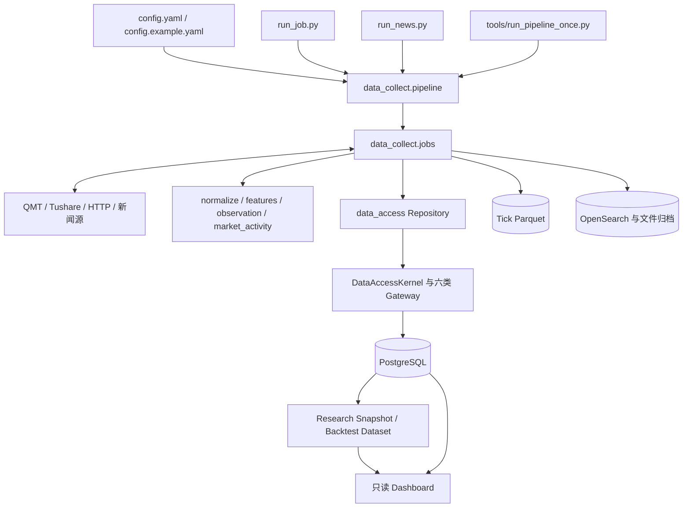

# 源码架构现状

> 核对日期：2026-10-12。本文按当前工作区的 Python 源码、示例配置、SQL 迁移和测试整理；不读取本机 `config.yaml`、数据库或外部服务，因此不代表某个部署环境的运行状态。具体行为以代码和迁移为准。

## 系统轮廓

项目围绕一个共享的 Python 包 `data_collect` 提供多类金融数据流程：QMT 行情采集、Tushare 数据基座、新闻采集、市场观察、研究快照、回测和纸面组合。它们复用配置加载、DAG 编排和数据访问模块，但入口和运行约束不同。



图中的数据流是模块关系的概括；具体任务是否启用由部署配置决定。

## 入口与编排

| 入口/模块 | 源码职责 |
| --- | --- |
| `run_job.py` | 非新闻 pipeline 的 CLI 和 scheduler 入口，覆盖行情任务及 Tushare 生产链；解析 pipeline、backfill、verify 等命令，并委托给共享编排器。 |
| `run_news.py` | 新闻任务的独立入口；复用 `run_job.py` 的调度实现，同时拒绝非新闻 pipeline。 |
| `tools/run_pipeline_once.py` | 单次启动配置中的一条 pipeline，供脚本化运行使用；本身不实现数据库访问。 |
| `data_collect/config.py` | 从 `config.yaml` 或 `DATA_COLLECT_CONFIG` 指定的文件加载数据库、数据源及 pipeline 配置。 |
| `data_collect/pipeline.py` | 依赖排序、任务模块加载、平台过滤、子进程隔离、超时/重试、失败后跳过下游，并校验生产 DAG 的任务和依赖。 |

`config.example.yaml` 同时包含旧行情/新闻 pipelines 和 `tushare_production_daily`。本机 `config.yaml` 被忽略且未在本文中读取，部署中的实际调度可能不同。

## Tushare 日生产链

示例配置和 `data_collect/pipeline.py` 的生产契约共同规定了以下链路：

```text
production_instrument_raw
  → production_market_raw
  → production_phase2_raw
      ├─→ production_market_derived ─┐
      └─→ production_financial_raw  → production_financial_derived ─┤
                                                                  ↓
                                                    production_quality
                                                                  ↓
                                                  production_market_activity
```

`production_market_anomaly_outcome` 在示例配置中被注释，默认未加入该链路；编排器为它保留了显式可选契约。全历史 Release、Research Snapshot 和 Backtest Dataset 作业在编排代码中被列为不可直接加入日生产 DAG 的入口，避免把无界作业挂入每日任务。

## Python 模块地图

| 目录 | 主要职责 | 代表源码 |
| --- | --- | --- |
| `data_collect/jobs/` | 任务入口和流程协调，覆盖采集、修复、迁移、质量检查、观察、快照和回测任务。 | `tushare_foundation_pipeline.py`、`market_activity_production_daily.py`、`research_snapshot.py` |
| `data_collect/providers/` | 数据源客户端。 | `tushare_client.py` |
| `data_collect/normalize/` | 将 Tushare 响应转换成项目字段和日期/数值类型。 | `tushare_daily.py`、`tushare_financial.py` |
| `data_collect/features/` | 可复用的技术和财务 Feature 计算。 | `technical_daily.py`、`financial_v2.py` |
| `data_collect/data_access/` | 数据访问策略、查询范围、事务、分块、检查点、Gateway 和 Repository。 | `kernel.py`、`context.py`、`dataset_policy.py`、`repository/` |
| `data_collect/observation/` | 市场异常和后验结果的契约、哈希、纯计算与有界评估逻辑。 | `contracts.py`、`market_activity_rules.py`、`outcome_evaluator.py` |
| `data_collect/market_activity/` | 市场成交活动指标、监控和持久化编排。 | `metrics.py`、`monitor.py`、`persistence.py` |
| `data_collect/backtest/` | 回测模型、策略、风险规则和执行引擎。引擎接收已冻结的 Dataset，不在回测中查询 PostgreSQL。 | `engine.py`、`models.py`、`strategy/` |
| `data_collect/portfolio/` | 需要人工批准的纸面组合模拟；实现不连接券商、不发送订单。 | `engine.py`、`models.py` |
| `data_collect/decision/` | 从已冻结研究快照生成候选和审阅材料。 | `candidate_service.py`、`audit_service.py` |
| `data_collect/evaluation/` | 对已持久化的回测事实或诊断结果做可重建评估。 | `standard.py`、`markdown.py` |
| `data_collect/web/` | 回测与市场活动 Dashboard 的 HTTP 处理和页面。 | `backtest_dashboard.py`、`market_activity_dashboard.py` |
| `data_collect/utils/` | 日期、指标、行情客户端、新闻检索/归档、通知和通用转换等共享适配工具。 | `date_utils.py`、`opensearch_utils.py`、`news_archive.py` |

## 数据访问和存储

- `DataAccessKernel` 持有事务、重试、锁、查询守卫、分块和检查点能力；业务代码通过 `raw`、`read`、`write`、`rebuild`、`publish`、`quality` 六类 Gateway 调用它。
- `data_collect/data_access/repository/` 放置按领域组织的 Repository 和 SQL。Job 负责流程协调，Repository 负责数据读写实现。
- `tools/check_data_access_contract.py` 对业务模块和 Repository 执行静态契约扫描；它是可运行的检查工具，扫描范围以该脚本为准。
- `sql/` 保存版本化数据库迁移；表结构和索引应从迁移文件核对。
- PostgreSQL 承载结构化数据。Tick 采集模块按日读写 Parquet。新闻模块配有 OpenSearch 工具和文件归档工具；路径与连接参数来自部署配置。

## 研究、回测和展示

主要研究链由相应 Job 与 Repository 组织：市场数据和 Feature 发布后，Research Snapshot 将输入固定下来；Backtest Dataset 再固定回测所需行情、快照和规则，供 `data_collect/backtest/engine.py` 纯 Python 执行。具体可用状态须检查数据库中的发布记录，不能从源码结构推断某个 Snapshot 或 Dataset 已存在。

`data_collect/backtest/strategy/quality_trend_rotation_v1.py` 定义策略信号规则，`strategy/contract.py` 固定信号与执行时点契约。`decision/` 产生待审阅候选；`portfolio/` 只模拟经人工批准的纸面意图。两个 Dashboard 从 Repository 读取已有结果，不是数据生产入口。

Backtest Dataset 的创建、物化构建、校验（含 FAILED 恢复）、基准修复、替换 Dataset 准备、组合 Dataset 组件写入和冻结，共用按 Dataset ID 区分的 PostgreSQL 会话级生命周期锁。生命周期操作按顺序等待同一 Dataset 的锁；不同 Dataset 可并行。长时间流式校验只占用对应 Dataset 的锁，不占用全局仓库写锁，避免校验看到分批构建中的部分物料并将过期哈希证明冻结。

Research Snapshot 的构建、单条/批量校验和单条/批量冻结，以及系列恢复、重开和 lineage 重建准备，也共用按 Snapshot ID 区分的 PostgreSQL 会话级生命周期锁；批量操作按稳定 ID 顺序取锁。构建开始后的异常在锁释放前将仍处于 `BUILDING` 的 Snapshot 标记为 `FAILED`，避免验证器观察到半成品。只读诊断查询不改变生命周期状态，因此不获取该锁。

开盘撮合使用涨跌停价和当日开盘价判断是否封板；涨跌停价对缺失或任一价格无效时按不可撮合处理。日终派生的 `can_buy`/`can_sell` 不作为开盘门禁，避免把收盘状态带入开盘决策。日线不能证明集合竞价排队或实际流动性，因此通过该门禁仍只是回测假设。该撮合语义由 `daily-next-open-v4` 标识。

## 查阅代码的入口

- 任务和每日生产拓扑：`config.example.yaml`、`data_collect/pipeline.py`
- CLI 行为：`run_job.py`、`run_news.py`、`tools/run_pipeline_once.py`
- 数据访问接口和策略：`data_collect/data_access/kernel.py`、`data_collect/data_access/repository/`
- 市场观察计算：`data_collect/market_activity/`、`data_collect/observation/`
- 研究与回测：`data_collect/jobs/research_snapshot.py`、`data_collect/jobs/backtest_dataset.py`、`data_collect/backtest/`
- 数据库结构：`sql/`
- 自动化验证：`tests/`、`tools/check_data_access_contract.py`

本文只描述源码模块和可见的配置链路，不记录数据库当前行数、部署进程、生产发布状态或外部接口可用性。代码发生模块级变化时更新本文；领域规则直接核对对应源码、SQL 迁移和测试。
